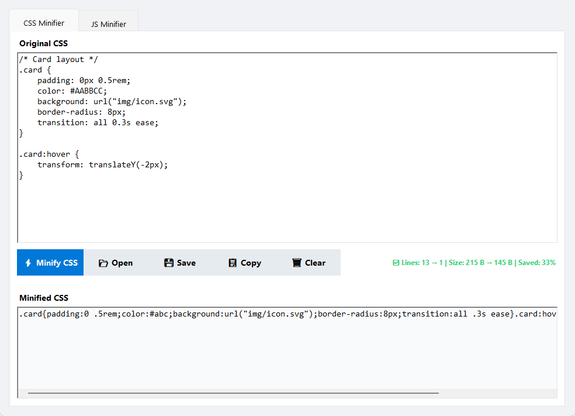

<div align="center">

# Code Minifier Pro

**A fast, offline CSS and JavaScript minifier for Windows.**

Paste code, drop a file, or open one — then copy or save the minified result.
No uploads, no accounts, no telemetry. Everything runs on your machine.

[](https://github.com/kopolart/CodeMinifier/actions/workflows/ci.yml)
[](#requirements)
[](#requirements)
[](LICENSE)

</div>

---

## Overview

Code Minifier Pro is a native WinForms desktop application that removes everything a browser or runtime does not need from CSS and JavaScript: comments, redundant whitespace, trailing semicolons, and other safe redundancies.

It is built for people who want a **quick, local, dependency-free** alternative to web-based minifiers — no code ever leaves the machine.



### Why this project

- **Fully offline.** The application makes no network calls and has no third-party runtime dependencies.
- **Syntax-aware, not regex-only.** Strings, `url(...)`, `calc()` expressions, CSS custom properties, JavaScript template literals, and regex literals are scanned and preserved instead of being blindly rewritten.
- **Conservative by design.** When a construct is ambiguous, the minifier keeps the safe form. Output is valid over being maximally small.
- **Built for real files.** A custom `RichTextBox` removes the default 64 KB text limit, and files over 50 MB trigger a confirmation prompt.
- **Immediate feedback.** Every run reports line counts, UTF-8 byte sizes, and the percentage saved.

## Features

| | CSS | JavaScript |
|---|:---:|:---:|
| Remove comments | Yes, except `/*! ... */` | Yes, except `/*! ... */` |
| Collapse whitespace | Yes | Yes |
| Preserve strings and URLs | Yes | Yes |
| Preserve license comments | Yes | Yes |
| Compute compression stats | Yes | Yes |
| Drag & drop a file | Yes | Yes |
| Open / save from disk | Yes | Yes |
| Copy to clipboard | Yes | Yes |

Additional behavior:

- **Automatic semicolon insertion safety** — line breaks that could change JavaScript semantics are kept.
- **Regex literal detection** — `/pattern/` is recognized after keywords and control-statement parentheses, so division and regex are not confused.
- **CSS value optimizations** — `0px` → `0`, `0.5` → `.5`, `#AABBCC` → `#abc`, hex colors lowercased, `!important` normalized.
- **UTF-8 without BOM** on save, with a BOM stripped on input if one is present.

## Requirements

- **Windows 7 SP1 or later** (Windows 10/11 recommended)
- **.NET Framework 4.8** runtime — included with Windows 10 (1903+) and Windows 11
- To build from source: **Visual Studio 2022** with the *.NET desktop development* workload, or **MSBuild 17+**

## Install

### Download the release

1. Open the [Releases](../../releases) page.
2. Download `CodeMinifier-vX.Y.Z-win.zip`.
3. Extract the archive and run `CodeMinifier.exe`. No installer is required.

The ZIP is portable: it contains the executable, its configuration file, the license, and this README.

### Build from source

```powershell
git clone https://github.com/kopolart/CodeMinifier.git
cd CodeMinifier
msbuild CodeMinifier\CodeMinifier.csproj /p:Configuration=Release
```

The executable is written to `CodeMinifier\bin\Release\CodeMinifier.exe`.

You can also open `CodeMinifier.slnx` in Visual Studio 2022 (17.13 or later) and build the solution.

## Usage

1. Select the **CSS** or **JS** tab.
2. Add code in one of three ways:
   - paste it into the top editor,
   - drag a `.css`, `.js`, or `.mjs` file onto the editor,
   - click **Open** and choose a file.
3. Click **Minify CSS** or **Minify JS**.
4. Click **Copy** to place the result on the clipboard, or **Save** to write it to disk.

The status line below the buttons shows the number of lines before and after, the size in bytes before and after, and the percentage saved.

### Examples

**CSS**

Input:

```css
/* Card layout */
.card {
    padding: 0px 0.5rem;
    color: #AABBCC;
    background: url("img/icon.svg");
    transition: all 0.3s ease;
}
```

Output:

```css
.card{padding:0 .5rem;color:#abc;background:url("img/icon.svg");transition:all 0.3s ease}
```

**JavaScript**

Input:

```js
// Greeting
function greet(name) {
    return "Hello, " + name;
}
```

Output:

```js
function greet(name){return"Hello, "+name;}
```

## Minification rules

### CSS

- Comments are removed; `/*! ... */` license comments are preserved.
- Runs of whitespace collapse to a single space, which is then dropped around structural characters (`{ } ; : , > ~`).
- Trailing semicolons before `}` are removed.
- Selector text is protected: `#Abc` as an ID selector is never treated as a color, and `a :hover` keeps its descendant combinator.
- `0px`-style zero values drop the unit for length units only. `0s`, `0deg`, `0fr`, and `0%` keep their units because removing them would produce invalid CSS.
- Leading zeros are removed from decimals (`.5`), hex colors are shortened when possible and lowercased.
- `calc()`, `min()`, `max()`, `clamp()`, `env()`, and `var()` are minified internally while preserving the mandatory spaces around `+` and `-`.
- Custom property values (`--name: ...`) are left untouched.
- `url(...)` contents, including data URIs, are never rewritten.
- `//` is **not** treated as a comment — unquoted URLs such as `--api: https://example.com` remain intact.

### JavaScript

- Comments are removed; `/*! ... */` license comments are preserved.
- Whitespace collapses to the minimum needed to keep tokens separate.
- Line breaks are retained wherever removing one could merge two statements under automatic semicolon insertion.
- Strings, template literals (including nested `${ ... }` expressions), and regex literals are preserved verbatim.
- A division sign followed by a regex literal receives a separating space, so the output never accidentally becomes `//`.
- Parentheses belonging to `if`, `while`, `for`, and `with` are tracked so a `/` after the closing `)` is read as a regex literal.
- Numbers support decimal, exponent, binary, octal, hexadecimal, bigint, and numeric separator forms.

## Architecture

```text
CodeMinifier/
├─ Program.cs                     Application entry point
├─ Controls/
│  └─ UnlimitedRichTextBox.cs     RichTextBox without the 64 KB limit
├─ Minification/
│  ├─ IMinifier.cs                Contract: Name + Minify(source)
│  ├─ CssMinifier.cs              Single-pass CSS minifier
│  └─ JsMinifier.cs               Single-pass JavaScript minifier
├─ UI/
│  ├─ MainForm.cs                 Window and language tabs
│  └─ MinifierTabView.cs          Reusable editor / actions / output view
└─ Properties/                    Assembly metadata and resources
```

**Design principles**

- Each language implements `IMinifier`, so adding a tab is a matter of implementing one interface and registering it in `MainForm`.
- The minifiers are single-pass character scanners with explicit state, not chains of regular expressions. This keeps them linear in input size and makes edge cases explicit.
- The UI is constructed in code without designer files, keeping the project small and reviewable.
- The application has no external dependencies beyond the .NET Framework itself.

## Limitations

- The minifiers are scanners, not full language parsers or validators. Invalid input is not reported as an error.
- No identifier renaming, dead-code elimination, or AST-level optimization.
- No source maps, bundling, or transpiling.
- Output is deliberately conservative, so another minifier may occasionally produce smaller output.

## Contributing

Contributions are welcome. Please read [CONTRIBUTING.md](CONTRIBUTING.md) before opening a pull request, and follow the [Code of Conduct](CODE_OF_CONDUCT.md).

- [Report a bug](../../issues/new?template=bug_report.yml)
- [Request a feature](../../issues/new?template=feature_request.yml)
- [Browse open issues](../../issues)

## Security

Code Minifier Pro handles untrusted text and local files, so reports about crashes, corrupted output, or unsafe file handling are taken seriously. Please follow [SECURITY.md](SECURITY.md) and do **not** open a public issue for a vulnerability.

## License

Released under the [MIT License](LICENSE).

---

<div align="center">
<sub>Built with .NET Framework 4.8 and Windows Forms.</sub>
</div>
